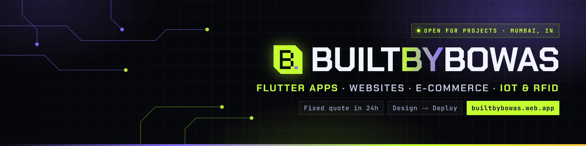
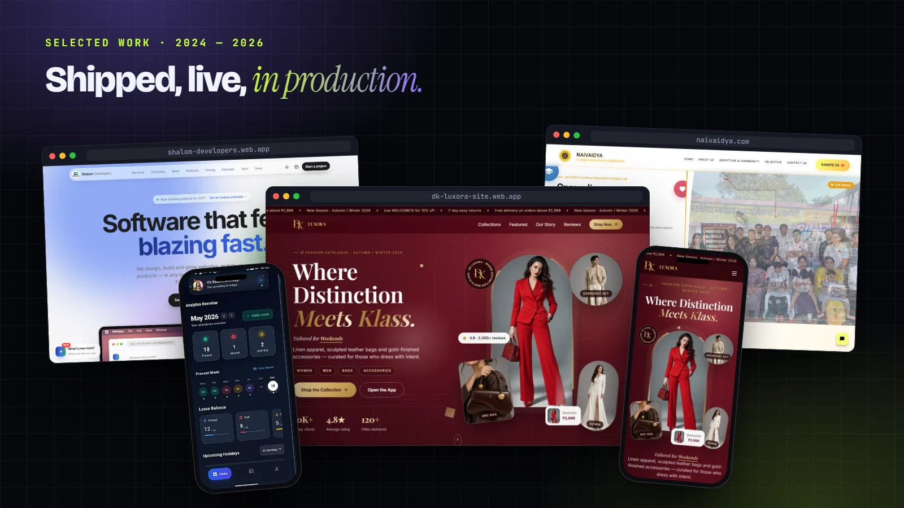

---

### 👋 Hey, I'm Bowas

I build **production apps and websites for businesses**, and the hardware they plug into.
Diploma in **Automation & Robotics**, so I'm as comfortable with an ESP32 and an RFID reader as with Flutter and Firebase.

- 📱 **Flutter apps**: Android + iOS + web from one codebase
- 🌐 **Websites & web apps**: fast, SEO-ready, deployed with domain & SSL
- 🛒 **E-commerce**: catalog, cart, checkout, order dashboards
- 📡 **IoT & RFID**: ESP32 firmware, gate access, live attendance dashboards
- 🛠️ **IT & servers**: Ubuntu, NGINX, Docker, networking

⚡ Fixed quote in 24h · weekly clickable previews · one developer from design to deploy

---

### 🚀 Selected work

| Project | What it is | Stack | Links |
|---|---|---|---|
| **DK Luxora** | Luxury fashion storefront & catalogue | HTML · CSS · JS · Firebase | [Live](https://dk-luxora-site.web.app/) |
| **Shalom Developers** | Software studio site with instant estimate tool | HTML · CSS · JS · Firebase | [Live](https://shalom-developers.web.app/) |
| **Naivaidya Foundation** | NGO website built to drive donations | HTML · CSS · JS | [Live](https://naivaidya.com/) |
| **Smartist Attend** | Workforce app: face-scan clock-in, leave, branch analytics | Flutter · Firebase | [Code](https://github.com/BuiltByBowas/smart_attendance) |
| **SMART RFID Gate** | UHF RFID school gate, auto attendance + parent alerts | ESP32 · RFID · Flutter | [Code](https://github.com/BuiltByBowas/smart_attendance) |
| **Gargi Digital** | Multi-brand electronics e-commerce (web + Android + iOS) | Flutter · Firebase | [Code](https://github.com/BuiltByBowas/gd) · [Live](https://gargidigital-click-shop-smile.web.app/) |
| **LensShop** | Billing & orders app for an optical store | Flutter · Firebase | [Code](https://github.com/BuiltByBowas/lensshop) · [Live](https://lensshop-1.web.app/) |
| **RC Hovercraft** | Final-year robotics project: ESP32, brushless lift/thrust, stepper steering | ESP32 · Embedded | [Code](https://github.com/BuiltByBowas/RC_hoverCraft) |

→ All 16 projects with screenshots and videos: <a href="https://builtbybowas.web.app/?utm_source=github&utm_medium=profile#projects">builtbybowas.web.app</a>

---

### 🧰 Stack

  

    

---

### 📊 Activity

  
  

<picture>
  <source media="(prefers-color-scheme: dark)" srcset="https://raw.githubusercontent.com/BuiltByBowas/builtbybowas/output/snake-dark.svg"/>
  
</picture>

---

**Have an app, website or smart system in mind?**
 
<a href="https://builtbybowas.web.app/?utm_source=github&utm_medium=profile#quote"><b>Get a fixed quote in 24 hours →</b></a>

